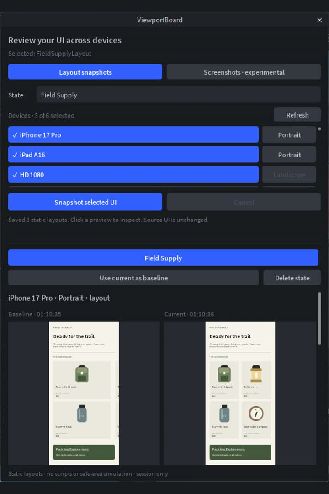

# ViewportBoard

Compare Roblox UI layouts across device sizes without losing your before-and-after reference.



[Watch the Studio demo](https://github.com/Ggaming5005/ViewportBoard/releases/download/v0.1.0/ViewportBoard-demo.mp4).

Select a ScreenGui or root GUI object, save its layout under a name, and pin a baseline. Edit your UI, snapshot the same state again, and inspect both versions side by side. Phone, tablet and desktop presets come from Studio. No framework or runtime dependency is required.

**Layout mode is a static property snapshot.** Native sizes, constraints and layout components are evaluated on virtual device canvases. Scripts and event connections are not run, and device safe areas are not simulated. This helps review layout changes; it does not replace Play testing.

## Install

Download `ViewportBoard.rbxm` from [Releases](https://github.com/Ggaming5005/ViewportBoard/releases). Insert it into a temporary Studio place, select its `ViewportBoard` Script, and choose **Save as Local Plugin**. Delete the inserted copy after installing. Open **Plugins → ViewportBoard**.

Or build with [Rojo](https://rojo.space/):

```sh
rojo build default.project.json -o ViewportBoard.rbxm
```

A recent Studio build exposing `StudioDeviceSimulatorService` is required for the device list. The plugin adds no scripts to your game.

## Snapshot and compare

1. Select one ScreenGui or root GUI object in Explorer. Keep **Layout snapshots** selected.
2. Name the state, for example `Shop`. Choose up to six devices and portrait or landscape for mobile presets.
3. Choose **Snapshot selected UI**.
4. Choose **Use current as baseline**, edit your source UI, then snapshot it under the same name.
5. Click a preview to inspect it. **Delete state** releases both versions.

The default selection contains one phone, tablet and desktop. The plugin remembers device choices. Up to three named states remain in memory for this Studio session; closing the panel retains them, and unloading the plugin clears them.

The original [Field Supply layout example](examples/README.md) demonstrates a fixed-width catalog clipping on a phone, then fitting after a change to scale-based sizing.

## What layout previews preserve

- The selected tree's properties, native layout components, sizes, constraints and aspect ratio.
- Source visibility, including a disabled ScreenGui, and Global/Sibling overlap ordering.
- The current UI state already represented in properties, such as text, colors, image references and scroll position.
- A baseline independent of later property edits to the source tree.

Previews use the preset's logical width and height with proportional display scaling. They do not apply ScreenGui safe-area/inset behavior, run responsive callbacks, recreate ancestor layouts outside the selected root, or render the surrounding game world. Select the complete ScreenGui when its parent layout matters. External styles, assets and live EditableImage references are not frozen into pixels. Video is paused and muted; scripts and audio players are removed from preview copies. Preview input and dragging are disabled.

The source tree is never modified. Each selected tree is limited to 800 instances, including descendants. Select a smaller section for larger interfaces.

## Experimental screenshots

The separate **Screenshots · experimental** mode uses Studio's simulator and capture APIs only after screenshot permission is granted. **On the tested Studio 0.747.0.7471481 build, `RequestScreenshotPermissionAsync()` reports `Feature not supported yet.` in both a test harness and an installed local plugin. Native screenshots could therefore not be verified and are not a supported v0.1 feature. Layout mode works without this permission.**

Where the API becomes available, screenshots are intended to capture the currently visible game view sequentially at selected device presets, restore the original simulator configuration, and retain previews with a 512-pixel longest edge. They represent Studio's rendered viewport rather than native-resolution device hardware. Permission, allocation and capture errors preserve the previous board. The plugin does not bypass unavailable APIs or change feature flags.

## Cleanup and limits

Snapshots are paired by mode, device ID and orientation. Different device sets show missing partners. Pinning transfers ownership instead of duplicating a set. Recapturing, deleting and unloading explicitly release retained trees and images. Closing the panel cancels an active batch.

Layout mode does not change simulator settings. Experimental screenshot batches save device, orientation, resolution, DPI and scaling, then attempt every restoration step even after failure. Cancellation waits for an in-flight native call. A Studio crash or forcibly terminated plugin cannot run cleanup.

There are no uploads, HTTP calls, accounts or API keys. No automatic clipping/accessibility detection or real-device performance claims are made.

## Develop

`Layout` owns static snapshots and their rendering. `Native` isolates version-sensitive simulator/capture APIs. `Batch` owns cancellation and partial-result cleanup; `Board` owns retained resources. `App` and `View` coordinate the Studio-themed interface.

```sh
luau tests/run.luau
luau-analyze src/Board.luau src/Batch.luau
```

`tests/Studio.spec.luau` runs engine checks against the actual Layout module. The production entry is `App.start(plugin)`; a fresh ModuleScript copy can be exercised with a test plugin and cleaned up through `app:Destroy()`.

See [research](docs/research.md) and [verification](docs/verification.md) for design references, observed Studio results and coverage limits.

MIT licensed. Built by [Ggaming5005](https://github.com/Ggaming5005).
